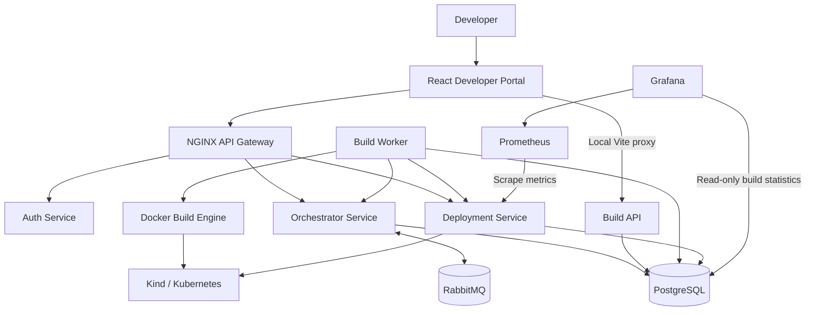

# DevSphere — System Architecture

## 1. Overview

DevSphere is a self-service Internal Developer Platform (IDP)
that automates application provisioning, container builds,
Kubernetes deployments, and operational monitoring.

Developers use a web portal instead of manually coordinating
multiple infrastructure tools.

## 2. High-Level Architecture

## 3. Application Lifecycle

1. Developer logs in through the React portal.
2. Orchestrator provisions the application project.
3. Build API creates a durable PostgreSQL build job.
4. Independent Build Worker builds a Docker image.
5. Docker image is loaded into the Kind cluster.
6. Deployment Service creates the Kubernetes workload.
7. Reconciler synchronizes deployment status with PostgreSQL.
8. Prometheus and Grafana monitor the platform.

## 4. Reliability

- PostgreSQL-backed build jobs
- Worker leases and heartbeats
- Retry and recovery support
- Deployment scaling and rollback
- Kubernetes status reconciliation

## 5. Security

- JWT authentication
- Developer ownership checks
- Kubernetes RBAC configuration
- Restricted container image allowlist
- Non-root containers and resource limits

## 6. Current Limitations

- Build Worker still uses developer JWTs for downstream requests.
- Kind is a local development Kubernetes environment.
- Production deployment requires additional security hardening.

