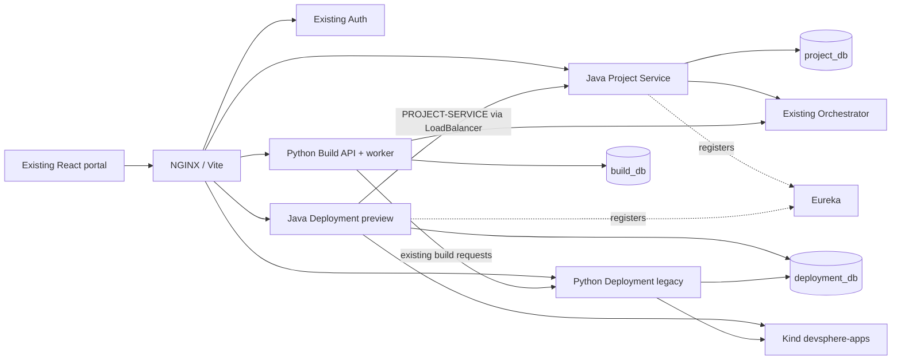

# Hybrid DevSphere architecture

The existing repository is extended in place. Three core business services are Project Management (Java), Deployment Management (Java preview), and Build Management (Python). Eureka is infrastructure and does not count as a business service. Auth, Catalog, Template and Orchestrator remain operational supporting services.

## Contracts and authority

Default external `/api/deployment/*` still reaches Python. `/api/deployment-spring/*` reaches Java. Java creates names `ds-java-*`, labels managed-by `devsphere-java`, owner and deployment UUID, and stores `management_service=java`. Python excludes that name prefix in its list, owned lookup and reconciler, independently of database migration order. Java lists its own records, reads legacy records for comparison, and rejects legacy mutations with 409. Neither controller adopts the other's resources.

A new Java deployment requires `project_id`. The Java-to-Java RestClient calls `http://PROJECT-SERVICE/projects/{id}` using Eureka and Spring Cloud LoadBalancer, forwards the bearer token and verifies returned owner. No static fallback exists. Missing project returns 404, discovery/downstream failure 503. Legacy Build Worker requests without project_id continue to Python.

Project records start as draft. The existing Orchestrator generates archives and registers Catalog entries. Linking `provisioningOperationId` requires an owned, completed provision_project operation with matching slug/template. Only then is the record provisioned. Deleting project metadata does not delete a build, artifact or deployment. A deployment can reference historical project metadata after deletion; no cross-database foreign key is claimed.

## Persistence and failure handling

Project uses JPA, transactions, owner/slug uniqueness and Flyway. Deployment uses existing public tables plus additive management_service/project_id columns. Its Flyway history lives in a separate `deployment_spring` schema, avoiding automatic baselining of public legacy tables. No startup DROP or table recreation. Deployment revisions retain the existing FK and uniqueness contract.

Kubernetes and SQL are separate systems. Creation first commits a deployment intent and initial revision; on Kubernetes failure it compensates only label-verified own resources and retains a failed audit row. Update/delete hold the SQL row lock; JSON Patch checks Kubernetes resourceVersion and changes only image/replicas. There remains a crash window between Kubernetes acknowledgement and SQL commit. Reconciliation refuses image/replica mismatches instead of overwriting operator changes; inspect and retry the same desired update to converge after such a crash. Failed partial cleanup is explicitly recorded. This is a practical control plane, not a distributed transaction.

## Security and limits

Existing Auth `/auth/me` validates tokens, active account and developer/admin role. No ownerId supplied by clients is trusted. No second login, JWT signing key duplication or administrator token. Java uses namespace-scoped service-account credentials, exact ownership-label validation, resource-version delete preconditions, non-root UID 101 applications, dropped capabilities, RuntimeDefault seccomp and existing CPU/memory limits. Images retain the Python allowlist. The namespace Role is reused without cluster-admin.

Build retains PostgreSQL SKIP LOCKED, encrypted developer JWT, leases, heartbeat, retry and pipeline. Only queued label changes are accepted. Queued cancellation atomically sets existing failed status, cancellation reason and archived_at; terminal archive retains status/history. Archived jobs cannot be claimed or retried. No new status value or hard deletion.

## Version selection

Java 21 target; Spring Boot 4.1.2 / Spring Cloud 2025.1.4. Official compatibility: https://spring.io/projects/spring-cloud/ . Maven Central artifacts were resolved. Fabric8 8.0.0 BOM aligns all Kubernetes artifacts; Boot parent alone otherwise selects older transitive models. Monitoring adds a separate dashboard and scrape job, retaining existing panels/queries.
